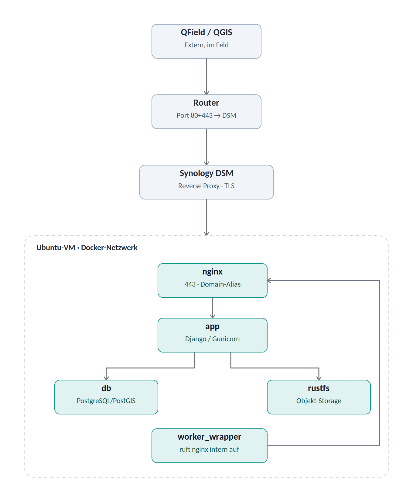
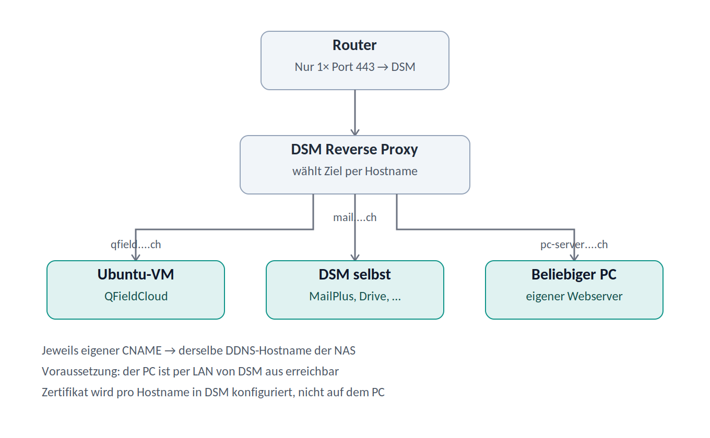

# Self-Hosted QFieldCloud – Deployment-Dokumentation

Datum: 9.–11. Juli 2026

Ziel-URL: https://qfield.example.com/

Status: Vollständig funktionsfähig. Web-Login, Backend-Health-Check und Datei-Synchronisation (Upload, Packaging und Download über QField) für ein reales ~320-MB-Projekt erfolgreich verifiziert (siehe Abschnitt 10).

## Inhaltsverzeichnis

- [1. Zusammenfassung](#1-zusammenfassung)
- [2. Infrastruktur-Übersicht](#2-infrastruktur-übersicht)
- [3. Voraussetzungen](#3-voraussetzungen)
- [4. DNS-Konfiguration](#4-dns-konfiguration)
- [5. Ubuntu-VM: Grundinstallation](#5-ubuntu-vm-grundinstallation)
  - [5.1 SSH-Zugriff aktivieren](#51-ssh-zugriff-aktivieren)
  - [5.2 Docker installieren (offizielles Repository)](#52-docker-installieren-offizielles-repository)
- [6. QFieldCloud: Installation](#6-qfieldcloud-installation)
  - [6.1 Repository klonen](#61-repository-klonen)
  - [6.2 Zentrale .env-Einstellungen](#62-zentrale-env-einstellungen)
  - [6.3 Stack starten und initialisieren](#63-stack-starten-und-initialisieren)
- [7. DSM: Zertifikat und Reverse Proxy](#7-dsm-zertifikat-und-reverse-proxy)
  - [7.1 Let's-Encrypt-Zertifikat anfordern](#71-lets-encrypt-zertifikat-anfordern)
  - [7.2 Reverse-Proxy-Regel](#72-reverse-proxy-regel)
  - [7.3 Zertifikat der Reverse-Proxy-Regel zuweisen](#73-zertifikat-der-reverse-proxy-regel-zuweisen)
- [8. Aufgetretene Probleme und Lösungen](#8-aufgetretene-probleme-und-lösungen)
- [9. Verifikation](#9-verifikation)
- [10. Tag 2 (10.–11. Juli): Datei-Synchronisation zum Laufen gebracht](#10-tag-2-1011-juli-datei-synchronisation-zum-laufen-gebracht)
  - [10.1 Root-Cause-Analyse](#101-root-cause-analyse)
  - [10.2 Diagnose-Bestätigung (temporär, nicht die Lösung)](#102-diagnose-bestätigung-temporär-nicht-die-lösung)
  - [10.3 Sackgasse: NGINX_ALLOW_INTERNAL_HTTP](#103-sackgasse-nginx_allow_internal_http)
  - [10.4 Die eigentliche Lösung](#104-die-eigentliche-lösung)
  - [10.5 Web-Login-Verwirrung (kein technischer Fehler)](#105-web-login-verwirrung-kein-technischer-fehler)
  - [10.6 Zweite Teilursache: nginx lehnte interne Anfragen mit 444 ab](#106-zweite-teilursache-nginx-lehnte-interne-anfragen-mit-444-ab)
  - [10.7 Dritte Teilursache: Verarbeitung dauert länger als der Standard-Timeout](#107-dritte-teilursache-verarbeitung-dauert-länger-als-der-standard-timeout)
  - [10.8 Vierte Teilursache: 413 Request Entity Too Large beim Rück-Upload](#108-vierte-teilursache-413-request-entity-too-large-beim-rück-upload)
  - [10.9 Kosmetischer Nachtrag: fehlende Static Files (404) im Admin-Bereich](#109-kosmetischer-nachtrag-fehlende-static-files-404-im-admin-bereich)
- [11. Offene Punkte / nächste Schritte](#11-offene-punkte--nächste-schritte)
- [12. Boot-Persistenz: Statische IP und Autostart](#12-boot-persistenz-statische-ip-und-autostart)
  - [12.1 Statische IP für die VM](#121-statische-ip-für-die-vm)
  - [12.2 Reverse-Proxy-Ziel aktualisiert](#122-reverse-proxy-ziel-aktualisiert)
  - [12.3 VM- und Docker-Autostart](#123-vm--und-docker-autostart)
  - [12.4 Praxis-Vorfall: DSM-7.4-Update (16. Juli 2026)](#124-praxis-vorfall-dsm-74-update-16-juli-2026)
- [13. Backup-Konzept](#13-backup-konzept)
  - [13.1 NFS-Freigabe auf DSM](#131-nfs-freigabe-auf-dsm)
  - [13.2 Einbindung in der VM](#132-einbindung-in-der-vm)
  - [13.3 Backup-Skript](#133-backup-skript)
  - [13.4 Täglicher systemd-Timer](#134-täglicher-systemd-timer)
  - [13.5 Letzter Schritt: Hyper Backup](#135-letzter-schritt-hyper-backup)
  - [13.6 Datei-Versionierung innerhalb von QFieldCloud begrenzt](#136-datei-versionierung-innerhalb-von-qfieldcloud-begrenzt)
- [14. Wiederherstellung nach NAS-Ausfall / Datenverlust](#14-wiederherstellung-nach-nas-ausfall--datenverlust)
  - [14.1 Szenario A: VM verloren oder beschädigt, DSM/NAS intakt](#141-szenario-a-vm-verloren-oder-beschädigt-dsmnas-intakt)
  - [14.2 Szenario B: Komplettausfall der NAS-Hardware](#142-szenario-b-komplettausfall-der-nas-hardware)
  - [14.3 Restore-Test](#143-restore-test)
- [15. Exkurs: Wie der Reverse Proxy die Zielauswahl trifft](#15-exkurs-wie-der-reverse-proxy-die-zielauswahl-trifft)
  - [15.1 Zwei Entscheidungsebenen: SNI und Host-Header](#151-zwei-entscheidungsebenen-sni-und-host-header)
  - [15.2 Mehrere Server hinter einem einzigen Port 443](#152-mehrere-server-hinter-einem-einzigen-port-443)
- [16. Referenzen](#16-referenzen)

## 1. Zusammenfassung

Diese Dokumentation beschreibt den erfolgreichen Weg zur Einrichtung einer selbst gehosteten QFieldCloud-Instanz auf einer Synology DS1517+, betrieben in einer Ubuntu-VM über den Synology Virtual Machine Manager. TLS-Terminierung und öffentlicher Zugriff laufen über DSMs eigenen Reverse Proxy, das eigentliche QFieldCloud-Backend läuft als Docker-Compose-Stack (Standalone-Konfiguration) innerhalb der VM.

Die komplette Zugriffskette:

| **Komponente** | **Status** |
|---|---|
| DNS (CNAME) | qfield.example.com → meinnas.synology.me → dynamische IP |
| Router-Portweiterleitung | Port 80 + 443 → DSM |
| TLS-Zertifikat | Let's Encrypt, verwaltet durch DSM, Auto-Renewal alle ~60 Tage |
| Reverse Proxy | DSM Anmeldeportal → HTTPS 443 → VM HTTPS 443 |
| Virtualisierung | Synology Virtual Machine Manager, Ubuntu 24.04 LTS Gast |
| Anwendung | QFieldCloud (Docker Compose, Standalone-Konfiguration) |

## 2. Infrastruktur-Übersicht

| **Parameter** | **Wert** |
|---|---|
| NAS-Modell | Synology DS1517+ (Intel Atom C2538, 4 Kerne / 4 Threads) |
| Virtualisierung | Synology Virtual Machine Manager (KVM) |
| Gast-Betriebssystem | Ubuntu Server 24.04 LTS |
| VM – vCPUs | 4 (entspricht der vollen physischen CPU-Kapazität des NAS) |
| VM – RAM | 6 GB |
| Netzwerk-Modus | Bridge (Open vSwitch) – eigene LAN-IP, unabhängig von DSM |
| VM – IP-Adresse | 192.168.1.20 (statisch, seit 11. Juli via Netplan, siehe Abschnitt 12.1) |
| Domain | example.com (Subdomain: qfield.example.com) |
| DDNS-Hostname (Synology) | meinnas.synology.me |

> **Hinweis:** Mit 4 vCPUs ist der VM praktisch die gesamte physische CPU-Kapazität des NAS zugewiesen. DSM selbst (Dateidienste, Backup, Indexierung) teilt sich dieselben 4 Threads. Bei spürbarer Trägheit der DSM-Oberfläche während QFieldCloud-Jobs: in Virtual Machine Manager auf 3 vCPUs reduzieren und 1 Thread dem Host reservieren.

## 3. Voraussetzungen

- Domain example.com mit Zugriff auf die DNS-Verwaltung beim Registrar

- Synology DDNS aktiviert (meinnas.synology.me) – hält die öffentliche IP automatisch aktuell

- Ubuntu 24.04-VM im Virtual Machine Manager, Netzwerk-Adapter im Bridge-Modus (eigene LAN-IP, nicht NAT)

- Router-Portweiterleitung für Port 80 und 443 auf die DSM-IP

## 4. DNS-Konfiguration

Beim Domain-Registrar wurde folgender CNAME-Eintrag angelegt:

```bash
Name (Host):   qfield
Typ:           CNAME
Ziel:          meinnas.synology.me
TTL:           300
```

Dadurch folgt qfield.example.com automatisch jeder IP-Änderung, die Synologys DDNS-Dienst für meinnas.synology.me nachträgt – ohne zusätzliche Konfiguration beim Registrar.

Verifiziert mit:

```bash
nslookup qfield.example.com 1.1.1.1
```

## 5. Ubuntu-VM: Grundinstallation

### 5.1 SSH-Zugriff aktivieren

Über die Browser-Konsole des Virtual Machine Manager (Virtuelle Maschine → Verbinden):

```bash
sudo apt update
sudo apt install -y openssh-server
sudo systemctl enable --now ssh
sudo ufw allow 22/tcp    # falls UFW bereits aktiv
ip a                     # LAN-IP der VM ermitteln
```

### 5.2 Docker installieren (offizielles Repository)

```bash
sudo apt update
sudo apt install -y ca-certificates curl gnupg
sudo install -m 0755 -d /etc/apt/keyrings
curl -fsSL https://download.docker.com/linux/ubuntu/gpg | sudo gpg --dearmor -o /etc/apt/keyrings/docker.gpg
echo "deb [arch=$(dpkg --print-architecture) signed-by=/etc/apt/keyrings/docker.gpg] https://download.docker.com/linux/ubuntu $(. /etc/os-release && echo $VERSION_CODENAME) stable" | sudo tee /etc/apt/sources.list.d/docker.list
sudo apt update
sudo apt install -y docker-ce docker-ce-cli containerd.io docker-compose-plugin
sudo usermod -aG docker $USER
```

## 6. QFieldCloud: Installation

### 6.1 Repository klonen

```bash
mkdir -p ~/qfieldcloud && cd ~/qfieldcloud
git clone --recurse-submodules https://github.com/opengisch/QFieldCloud.git .
cp .env.example .env
```

### 6.2 Zentrale .env-Einstellungen

| **Variable** | **Gesetzter Wert / Hinweis** |
|---|---|
| QFIELDCLOUD_HOST | qfield.example.com |
| DJANGO_ALLOWED_HOSTS | qfield.example.com localhost 127.0.0.1 app nginx |
| WEB_HTTP_PORT | 80 |
| COMPOSE_FILE | docker-compose.yml:docker-compose.override.standalone.yml |
| SECRET_KEY / SALT_KEY | je ein individueller Wert, generiert mit openssl rand -base64 96 – siehe Passwort-Manager |
| POSTGRES_PASSWORD | individuelles starkes Passwort – siehe Passwort-Manager |
| OBJECT_STORAGE_ROOT_USER/PASSWORD | qfieldadmin / individuelles Passwort – siehe Passwort-Manager. WICHTIG: dieselben Werte auch im STORAGES-JSON-Block (access_key/secret_key) eintragen – werden nicht automatisch synchronisiert! |

> **Sicherheitshinweis:** Die tatsächlichen Geheimwerte (SECRET_KEY, SALT_KEY, POSTGRES_PASSWORD, OBJECT_STORAGE_ROOT_PASSWORD) sind bewusst nicht in diesem Dokument aufgeführt. Sie befinden sich in der .env-Datei auf der VM (~/qfieldcloud/.env) sowie im Passwort-Manager.

### 6.3 Stack starten und initialisieren

```bash
docker compose up -d --build
docker compose exec app python manage.py migrate
docker compose exec app python manage.py collectstatic --noinput
docker compose exec app python manage.py createsuperuser
```

Erwartetes Ergebnis von docker compose ps: alle Services (app, db, nginx, worker_wrapper, rustfs, memcached, ofelia, certbot, mkcert, smtp4dev, webdav) im Status Up.

## 7. DSM: Zertifikat und Reverse Proxy

### 7.1 Let's-Encrypt-Zertifikat anfordern

Systemsteuerung → Sicherheit → Zertifikat → Hinzufügen → Neues Zertifikat hinzufügen → Zertifikat von Let's Encrypt abrufen.

```bash
Domainname:  qfield.example.com
E-Mail:      <Kontakt-E-Mail für Ablauf-Warnungen>
```

Voraussetzung: Port 80 muss von aussen auf die DSM-IP erreichbar sein (HTTP-01-Challenge).

### 7.2 Reverse-Proxy-Regel

Systemsteuerung → Anmeldeportal → Erweitert → Reverse Proxy → Erstellen (Name: QFieldCloud):

| **Feld** | **Quelle** | **Ziel** |
|---|---|---|
| Protokoll | HTTPS | HTTPS |
| Hostname | qfield.example.com | 192.168.1.20 (statische IP der VM) |
| Port | 443 | 443 |
| Sonstiges | HSTS aktiviert | Ziel-Zertifikat (mkcert, selbstsigniert) wird von DSM nicht geprüft |

> **Kritischer Punkt:** Das Ziel-Protokoll muss HTTPS sein, nicht HTTP. Mit Ziel-Protokoll HTTP und Port 443 oder 80 entsteht ein Redirect-Loop, da nginx im QFieldCloud-Container jede Klartext-Verbindung auf HTTPS umleitet, DSM diese Umleitung aber wieder als Klartext weiterreicht (siehe Abschnitt 8).

### 7.3 Zertifikat der Reverse-Proxy-Regel zuweisen

Systemsteuerung → Sicherheit → Zertifikat → das qfield.example.com-Zertifikat auswählen → Einstellungen → dem Dienst „qfield.example.com“ (erscheint automatisch nach Anlage der Reverse-Proxy-Regel) dieses Zertifikat zuordnen.

## 8. Aufgetretene Probleme und Lösungen

Chronologische Übersicht der Probleme, die während der Einrichtung auftraten – als Referenz für künftige Fehlersuche oder eine erneute Einrichtung:

| **Symptom** | **Ursache** | **Lösung** |
|---|---|---|
| nslookup: NXDOMAIN für qfield.example.com | DNS-Propagation noch nicht abgeschlossen (TTL 300s) | Kurz gewartet, mit anderem Resolver (1.1.1.1) erneut getestet |
| Let's-Encrypt-Dialog kehrt in Endlosschleife zur Warnung zurück | Port 80 war am Router nicht weitergeleitet (nur 443) | Portweiterleitung für Port 80 → DSM ergänzt |
| curl liefert 502 Bad Gateway | Docker/QFieldCloud auf der VM noch nicht installiert bzw. gestartet | Docker-Installation und docker compose up -d --build nachgeholt |
| curl liefert 302-Redirect-Schleife auf https://…:443/ | Reverse-Proxy-Ziel zeigte auf HTTP:80, nginx im Container erzwingt aber HTTPS-Redirect | Reverse-Proxy-Ziel auf Protokoll HTTPS / Port 443 umgestellt (Ziel-Zertifikat: mkcert, wird von DSM nicht geprüft) |
| worker_wrapper-Container in Neustart-Schleife (Restarting) | Datenbank-Migrationen noch nicht ausgeführt (Tabelle constance_constance fehlte) | docker compose exec app python manage.py migrate ausgeführt |
| 500 Internal Server Error beim Login (Missing staticfiles manifest entry für css/vendor.css) | collectstatic war noch nicht gelaufen | collectstatic --noinput ausgeführt |
| 500-Fehler bestand nach collectstatic weiterhin | Bereits laufende Gunicorn-Worker hatten das alte Manifest im Speicher (kein Hot-Reload) | docker compose restart app |

## 9. Verifikation

Abschliessender Test der kompletten Kette von aussen:

```bash
curl -v https://qfield.example.com/admin/login/
curl -s https://qfield.example.com/api/v1/status/ | python3 -m json.tool
```

Erwartete Antwort des Status-Endpunkts:

```bash
{
    "database": "ok",
    "storage": "ok"
}
```

Beide Tests wurden am 9. Juli 2026 erfolgreich durchgeführt. Login über das Web-Interface mit dem angelegten Superuser-Account funktioniert.

## 10. Tag 2 (10.–11. Juli): Datei-Synchronisation zum Laufen gebracht

Nach erfolgreichem Web-Login zeigte sich beim ersten Sync-Versuch über QGIS/QFieldSync bzw. QField auf dem iPhone ein neuer Fehler: Projekte blieben auf Status Rot („failed_process_projectfile“) bzw. der Datei-Download in QField schlug mit „A network error has occurred“ fehl.



Abbildung: Zugriffskette von aussen nach innen (oben) und der interne Rückweg von worker_wrapper über nginx (rechter Pfeil)

### 10.1 Root-Cause-Analyse

In den worker_wrapper-Logs erschien wiederholt:

```bash
GET http://app:8000/api/v1/files/.../datei.gpkg/ got HTTP 500
```

Im app-Container-Log dazu der eigentliche Python-Fehler:

```bash
Exception: Expected to either run behind nginx proxy, debug mode or within a test suite.
```

Der Grund, gefunden direkt im Quellcode (docker-app/qfieldcloud/filestorage/view_helpers.py, ca. Zeile 276):

```bash
if "X-Forwarded-For" in request.headers and not settings.IN_TEST_SUITE:
```

QFieldCloud nutzt für die Dateiauslieferung den nginx-Mechanismus X-Accel-Redirect (nginx liefert die Datei direkt aus dem Storage, ohne dass sie durch den Python-Prozess läuft). Die App erkennt „hinter nginx“ anhand des X-Forwarded-For-Headers. Der worker_wrapper-Container ruft Dateien aber standardmässig direkt intern auf (http://app:8000/…), unter Umgehung von nginx – entsprechend fehlt der Header, und ohne DEBUG=1 bleibt nur eine 500-Exception.

### 10.2 Diagnose-Bestätigung (temporär, nicht die Lösung)

Zur Bestätigung wurde kurzzeitig DEBUG=1 gesetzt (dritte, in der Exception genannte Bedingung, die den Check umgeht). Damit lief der Sync fehlerfrei durch – bestätigte die Diagnose zu 100 %. DEBUG=1 darf aber nicht dauerhaft aktiv bleiben (Django zeigt sonst bei jedem Fehler vollständige Stack-Traces inkl. Umgebungsvariablen öffentlich an) und wurde wieder auf 0 zurückgesetzt.

### 10.3 Sackgasse: NGINX_ALLOW_INTERNAL_HTTP

Ein naheliegender erster Versuch war die Variable NGINX_ALLOW_INTERNAL_HTTP=1 in der .env. Sie wird jedoch ausschliesslich an den nginx-Container durchgereicht (nicht an app) – für sich allein löst sie den beschriebenen Fehler nicht. Sie ist aber, wie sich in 10.4 zeigt, trotzdem notwendig als Begleit-Einstellung.

### 10.4 Die eigentliche Lösung

Der Worker liest die interne API-Adresse aus einer eigenen Variable:

```bash
QFIELDCLOUD_WORKER_QFIELDCLOUD_URL=http://app:8000/api/v1/   # vorher
```

Geändert auf den Weg über nginx, damit dieser den nötigen X-Forwarded-For-Header setzt:

```bash
QFIELDCLOUD_WORKER_QFIELDCLOUD_URL=http://nginx/api/v1/   # nachher
```

> **Wichtig:** Beide Einstellungen gehören zusammen. NGINX_ALLOW_INTERNAL_HTTP=1 lässt nginx die nun eintreffende interne Klartext-HTTP-Anfrage vom Worker akzeptieren, ohne sie auf HTTPS umzuleiten (was sonst wieder zu einem Redirect-Loop geführt hätte, wie in Abschnitt 8 bei der externen Anfrage). QFIELDCLOUD_WORKER_QFIELDCLOUD_URL=http://nginx/api/v1/ leitet den Worker-Traffic über nginx um, wodurch der X-Forwarded-For-Header gesetzt wird, den der Code in Abschnitt 10.1 prüft.

Nach Anpassung in der .env:

```bash
docker compose up -d --force-recreate worker_wrapper
# Test: Sync in QGIS/QField auslösen, dann:
docker compose logs --tail=30 worker_wrapper | tail -15
```

Ergebnis: process_projectfile-Job lief fehlerfrei durch (Finished execution with code 0, kein HTTP 500 mehr). Für das grosse Testprojekt (Stadt_Zuerich_Gebaeudealter_cloud) wechselte der Status danach auf Grün, der Download in QField auf dem iPhone war erfolgreich.

### 10.5 Web-Login-Verwirrung (kein technischer Fehler)

Parallel dazu trat mehrfach „Zu viele Umleitungen“ beim Aufruf von /admin/ auf (Safari und Chrome). Ausführliche Diagnose (CSRF-Token, Cookies, curl-Tests mit Cookie-Jar, Session-Engine, SECURE_PROXY_SSL_HEADER) zeigte: Die gesamte Technik funktionierte korrekt. Ursache war, dass mit einem regulären Benutzerkonto statt dem Superuser-Konto eingeloggt wurde – ein Konto ohne is_staff-Recht wird von /admin/ grundsätzlich abgewiesen, was sich wie ein Redirect-Loop bemerkbar macht. Mit dem richtigen Superuser-Account funktioniert der Login einwandfrei.

> **Hinweis für künftige Fehlersuche:** Bei „Zu viele Umleitungen“ auf /admin/ zuerst prüfen, ob tatsächlich mit einem Konto mit is_staff=True eingeloggt wird, bevor man CSRF/Cookie/Proxy-Konfiguration verdächtigt.

### 10.6 Zweite Teilursache: nginx lehnte interne Anfragen mit 444 ab

Nach dem Fix in 10.4 verschwand der HTTP-500-Fehler, Jobs liefen scheinbar fehlerfrei durch (Finished execution with code 0) – allerdings mit einem auffällig kurzen, unvollständigen Log (nur „Downloading project files…“, dann sofortiger Abbruch, ohne Layer-Validierung). Der Status blieb Rot bzw. Data last packaged at blieb leer.

Im nginx-Access-Log fand sich die Ursache:

```bash
172.18.0.12 - - "GET /api/v1/files/.../ HTTP/1.1" 444 0 "-" "sdk|py|... python-requests|..." "-"
```

nginx antwortet mit Status 444 (Verbindung ohne Antwort geschlossen) auf Anfragen, deren Host-Header nicht exakt dem öffentlichen Domainnamen entspricht. Der Worker verband sich über den Docker-internen Servicenamen (http://nginx/…), wodurch der Host-Header nginx statt qfield.example.com lautete – das matched zwar den server_name-Alias im 443-Block, nicht aber die separate IP-Zugriffsschutz-Prüfung (if ($http_host !~ „qfield.example.com...“) return 444;), die in beiden Server-Blöcken unabhängig davon greift.

Lösung: Statt den internen Servicenamen zu verwenden, wurde Docker so konfiguriert, dass der öffentliche Domainname intern direkt auf den nginx-Container auflöst (Network-Alias), sodass der Host-Header korrekt mitgeschickt wird:

```bash
# docker-compose.override.local.yml (neue, eigene Datei):
services:
  nginx:
    networks:
      default:
        aliases:
          - qfield.example.com
# .env:
COMPOSE_FILE=docker-compose.yml:docker-compose.override.standalone.yml:docker-compose.override.local.yml
QFIELDCLOUD_WORKER_QFIELDCLOUD_URL=http://qfield.example.com/api/v1/
```

Nach docker compose up -d --force-recreate löst der Worker den öffentlichen Domainnamen intern auf eine Docker-interne IP auf (verifiziert per socket.gethostbyname, Ergebnis z. B. 172.18.0.12) – kein Umweg über Internet/Router/NAT-Loopback mehr nötig, und der Host-Header stimmt exakt.

### 10.7 Dritte Teilursache: Verarbeitung dauert länger als der Standard-Timeout

Mit dem nginx-Fix lief die Verarbeitung zwar vollständig (Layer-Validierung, Packaging-Start), brach aber nach genau 10 Minuten mit einem Docker-API-Timeout ab (container.wait(timeout=self.container_timeout_secs) in worker_wrapper/wrapper.py). Der Wert stammt aus einer Django-Constance-Einstellung (config.WORKER_TIMEOUT_S), dynamisch in der Datenbank gespeichert, Default 600 Sekunden.

Erhöht auf 1800 Sekunden (30 Minuten):

```bash
docker compose exec app python manage.py shell -c "
from constance import config
config.WORKER_TIMEOUT_S = 1800
"
```

> **Wichtig:** Der worker_wrapper-Container cacht den Wert beim Start – nach einer Constance-Änderung ist ein docker compose restart worker_wrapper nötig, damit der neue Timeout tatsächlich greift.

Mit 1800 Sekunden lief das Packaging für das ~320-MB-Projekt (zwei Vektor-Layer, fünf WMS/Raster-Layer) in ca. 22 Minuten vollständig durch (Packaging finished!). Der anschliessende Rück-Upload der gepackten ~320-MB-Datei data.gpkg scheiterte jedoch weiterhin, siehe 10.8.

### 10.8 Vierte Teilursache: 413 Request Entity Too Large beim Rück-Upload

Im nginx-Error-Log fand sich beim Upload-Versuch:

```bash
client intended to send too large body: 319901841 bytes ... 413
```

Die Config zeigte client_max_body_size 10g; im Port-443-Server-Block, aber keine entsprechende Direktive im Port-80-Block. Da QFIELDCLOUD_WORKER_QFIELDCLOUD_URL ohne Portangabe auf Port 80 zielte, griff dort nginx' interner Default von 1 MB statt der konfigurierten 10 GB.

Lösung: Worker-URL auf https:// (Port 443) umgestellt, wo das Limit korrekt gesetzt ist:

```bash
QFIELDCLOUD_WORKER_QFIELDCLOUD_URL=https://qfield.example.com/api/v1/
```

Das führte zu einem neuen Problem: Der Worker vertraute dem selbstsignierten mkcert-Zertifikat auf Port 443 nicht (SSLCertVerificationError). QFieldCloud sieht dafür einen eigenen Mechanismus vor – eine Datei conf/ca/custom_ca.crt, die als zusätzliche vertrauenswürdige CA eingebunden wird (Volume custom_ca_certificates, gemountet nach /etc/ssl/custom_certs/ in den Containern, die dieses Volume referenzieren).

```bash
# CA-Root-Zertifikat vom nginx-Container extrahieren:
docker compose cp nginx:/etc/nginx/certs/rootCA.pem conf/ca/custom_ca.crt
```

> **Wichtig:** Das Kopieren der Datei allein reicht nicht – weder das Entrypoint-Skript des worker_wrapper-Images noch ein manueller update-ca-certificates-Aufruf übernehmen die Datei automatisch in den von Python (requests/certifi) genutzten Trust-Store. Der zuverlässige Weg ist die Umgebungsvariable REQUESTS_CA_BUNDLE, die requests direkt auf die Zertifikatsdatei verweist. Diese Variable wird nicht automatisch von der .env an den worker_wrapper-Service durchgereicht (analog zu NGINX_ALLOW_INTERNAL_HTTP in 10.3) und musste über die eigene Override-Datei gesetzt werden.

Finale docker-compose.override.local.yml (kombiniert den Network-Alias aus 10.6 mit dem CA-Bundle-Pfad):

```bash
services:
  nginx:
    networks:
      default:
        aliases:
          - qfield.example.com
  worker_wrapper:
    environment:
      REQUESTS_CA_BUNDLE: /etc/ssl/custom_certs/custom_ca.crt
```

Nach docker compose up -d --force-recreate worker_wrapper lief ein kompletter package-Job (ausgelöst direkt über die REST-API, siehe unten) erstmals vollständig durch – inklusive erfolgreichem Rück-Upload der 320-MB-Datei (Uploading packaged project files finished!, Job-Endmarker 2 statt 1). Data last packaged at zeigte danach den korrekten, aktuellen Zeitstempel, und der Download in QField auf dem iPhone funktionierte.

> **Werkzeug-Tipp:** Ein package-Job lässt sich unabhängig von QGIS/QField direkt per REST-API auslösen – nützlich zum gezielten Nachstellen von Fehlern, ohne jedes Mal den Client zu bemühen: POST an /api/v1/jobs/ mit {"project_id": "<ID>", "type": "package"} (Session-Cookie und CSRF-Token vorher per Login gegen /accounts/login/ holen).

### 10.9 Kosmetischer Nachtrag: fehlende Static Files (404) im Admin-Bereich

Unabhängig von der eigentlichen Sync-Kette blieb das Django-Admin-Interface durchgehend nur teilweise gestylt (rohes HTML statt CSS/JS). Ursache: Das static_volume (und media_volume) ist in der offiziellen docker-compose.yml nur bei den Services app und worker_wrapper eingebunden, nicht bei nginx – nginx kann die Dateien unter /staticfiles/ also gar nicht ausliefern, unabhängig von jeder location-Konfiguration.

Lösung über zwei offiziell vorgesehene Erweiterungspunkte, ohne die Kern-Dateien anzufassen:

```bash
# 1) Eigener nginx-Location-Block, abgelegt im vorgesehenen Erweiterungsordner:
mkdir -p conf/nginx/config.d
cat > conf/nginx/config.d/staticfiles.conf << 'EOF'
location /staticfiles/ {
    alias /usr/src/app/staticfiles/;
}
location /mediafiles/ {
    alias /usr/src/app/mediafiles/;
}
EOF
# 2) Fehlendes Volume bei nginx ergänzen (docker-compose.override.local.yml):
services:
  nginx:
    volumes:
      - static_volume:/usr/src/app/staticfiles:ro
      - media_volume:/usr/src/app/mediafiles:ro

volumes:
  static_volume:
    external: true
    name: qfieldcloud_static_volume
  media_volume:
    external: true
    name: qfieldcloud_media_volume
```

> **Hinweis:** Der externe Volume-Name folgt dem Docker-Compose-Muster <projektname>_<volumename> – vor dem Eintragen mit docker volume ls prüfen, ob der Name tatsächlich qfieldcloud_static_volume lautet (abhängig vom COMPOSE_PROJECT_NAME).

Nach docker compose up -d --force-recreate nginx lädt das Admin-Interface vollständig gestylt (Sidebar, Icons, Layout wie im offiziellen Jazzmin-Theme vorgesehen).

## 11. Offene Punkte / nächste Schritte

- SECRET_KEY und SALT_KEY sind während der Fehlersuche mehrfach im Klartext in Terminal-Ausgaben aufgetaucht (u.a. via docker compose config). Rein als Hygiene-Massnahme empfiehlt es sich, beide Werte einmal neu zu generieren (openssl rand -base64 96) und in der .env zu ersetzen, dann docker compose up -d --force-recreate app worker_wrapper.

- UFW-Firewall auf der VM: Regeln für Port 80/443 (und ggf. weitere QFieldCloud-Ports) noch nicht abschliessend geprüft/gehärtet.

- systemd-Service für den Docker-Compose-Stack eingerichtet und per Stop/Start-Test bestätigt (Abschnitt 12.3). Noch ausstehend: ein vollständiger NAS-Reboot als Praxistest, inklusive Bestätigung, dass die VM-Autostart-Einstellung in Virtual Machine Manager tatsächlich aktiviert ist.

- Nicht benötigte Standalone-Dienste (smtp4dev, webdav) laufen aktuell mit – können bei Bedarf aus docker-compose.override.standalone.yml entfernt werden, um RAM zu sparen, insbesondere falls der bestehende Synology MailPlus Server stattdessen für E-Mail-Versand konfiguriert wird (EMAIL_HOST etc. in .env).

- Backup-Konzept: NFS-basierte tägliche Sicherung (Postgres-Dump + rustfs-Archiv + Konfigurationsdateien) eingerichtet und getestet, siehe Abschnitt 13. Noch offen: Hyper Backup selbst auf den Freigabeordner qfieldcloud-backup ansetzen (inkl. externer/Offsite-Kopie, sonst schützt das Backup nicht vor einem NAS-Totalausfall, siehe Abschnitt 14), sowie ein echter Restore-Test.

- NAT-Loopback im eigenen WLAN: Der erste Download-Versuch in QField schlug im Heimnetz fehl und funktionierte erst über Mobilfunk – deutet auf ein NAT-Loopback-Problem des Routers hin. Für den Alltagsgebrauch im eigenen Netz lohnt sich ein lokaler DNS-Eintrag, der qfield.example.com intern direkt auf die VM-IP auflöst, statt über den externen Umweg via Router/DSM.

## 12. Boot-Persistenz: Statische IP und Autostart

Nach erfolgreichem Abschluss der Datei-Synchronisation blieb ein Praxisproblem offen: Die Ubuntu-VM bezog ihre IP-Adresse per DHCP. Nach einem Neustart hätte sich diese IP ändern können – DSMs Reverse-Proxy-Ziel zeigt aber auf eine feste IP, wäre also nach einem Reboot ins Leere gelaufen, obwohl alle anderen Komponenten (Zertifikat, DNS, Docker-Stack) unverändert korrekt gewesen wären.

### 12.1 Statische IP für die VM

Die vorhandene DHCP-Konfiguration steckte in einer von cloud-init automatisch verwalteten Datei (50-cloud-init.yaml), die bei jedem Boot neu geschrieben werden kann. Statt diese direkt zu bearbeiten, wurde eine eigene, zusätzliche Netplan-Datei angelegt, die durch ihren späteren Dateinamen (99-) Vorrang erhält:

```bash
sudo tee /etc/netplan/99-static.yaml << 'EOF'
network:
  version: 2
  ethernets:
    ens3:
      dhcp4: false
      addresses:
        - 192.168.1.20/24
      routes:
        - to: default
          via: 192.168.1.1
      nameservers:
        addresses: [8.8.8.8, 8.8.4.4]
EOF
sudo chmod 600 /etc/netplan/99-static.yaml
```

Damit cloud-init bei einem künftigen Boot keine widersprüchliche Konfiguration mehr nachschiebt:

```bash
sudo tee /etc/cloud/cloud.cfg.d/99-disable-network-config.cfg << 'EOF'
network: {config: disabled}
EOF
```

> **Wichtig zu netplan try:** Der sichere Testbefehl netplan try wartet auf eine Bestätigung (Enter) und macht die Änderung nach 120 Sekunden automatisch rückgängig, falls keine erfolgt – diese Bestätigung muss aber in derselben Sitzung erfolgen, die den Befehl gestartet hat. Reisst die SSH-Verbindung durch den IP-Wechsel ab (normal) und man verbindet sich in einer neuen Sitzung, erreicht das dortige Enter den wartenden Prozess nicht, und es kommt zum automatischen Rollback. In diesem Fall half ein direktes sudo netplan apply (kein Zeitlimit, kein Rollback-Schutz) nach vorherigem sudo netplan generate zur Syntaxprüfung.

Nach sudo netplan apply und Neuverbindung unter der neuen Adresse zeigte ip a | grep ens3 die feste IP ohne dynamic-Kennzeichnung – die Konfiguration übersteht seither jeden Reboot.

### 12.2 Reverse-Proxy-Ziel aktualisiert

DSM Reverse Proxy → QFieldCloud-Regel → Ziel-Hostname von 192.168.1.200 auf 192.168.1.20 angepasst. Verifiziert über:

```bash
curl -s https://qfield.example.com/api/v1/status/
```

Ergebnis weiterhin {"database": "ok", "storage": "ok"} – diesmal über die neue, dauerhafte Adresse.

### 12.3 VM- und Docker-Autostart

Damit das System nach einem NAS-Neustart ohne manuelles Eingreifen wieder vollständig hochfährt, sind zwei weitere Ebenen nötig:

- Virtual Machine Manager → VM auswählen → Einstellungen → „Virtuelle Maschine beim Booten von DSM automatisch starten“ aktivieren.

- Docker selbst prüfen: sudo systemctl is-enabled docker (sollte enabled zeigen, ist bei Standardinstallation über apt bereits der Fall).

Für den Compose-Stack empfiehlt sich ein eigener systemd-Service, der beim VM-Boot automatisch docker compose up -d ausführt (berücksichtigt dabei automatisch alle .env- und Override-Anpassungen):

```bash
sudo tee /etc/systemd/system/qfieldcloud.service << 'EOF'
[Unit]
Description=QFieldCloud Docker Compose Stack
Requires=docker.service network-online.target
After=docker.service network-online.target

[Service]
Type=oneshot
RemainAfterExit=yes
WorkingDirectory=/root/qfieldcloud
ExecStart=/usr/bin/docker compose up -d
ExecStop=/usr/bin/docker compose down
TimeoutStartSec=0

[Install]
WantedBy=multi-user.target
EOF
sudo systemctl daemon-reload
sudo systemctl enable qfieldcloud.service
```

Funktionstest ohne kompletten NAS-Neustart, erfolgreich durchgeführt am 12. Juli 2026:

```bash
sudo systemctl stop qfieldcloud
docker compose ps   # Ergebnis: leere Liste, alle Container sauber gestoppt
sudo systemctl start qfieldcloud
docker compose ps   # Ergebnis: alle Container Up (nach ca. 15-20s vollständig bereit)
curl -s https://qfield.example.com/api/v1/status/
# Ergebnis: {"database":"ok","storage":"ok"}
```

> **Stolperstein bei der Einrichtung:** Ein erster Testlauf schlug mit status=200/CHDIR fehl, weil der Service ursprünglich mit WorkingDirectory=/home/benutzer/qfieldcloud angelegt worden war – die tatsächliche Installation liegt aber unter /root/qfieldcloud (die gesamte Einrichtung erfolgte durchgehend als root). Nach Korrektur des Pfads lief der Service fehlerfrei.

> **Timing-Hinweis:** Direkt nach sudo systemctl start qfieldcloud kann ein Zugriff über die öffentliche URL kurzzeitig Synologys eigene „Seite nicht gefunden“-Fehlerseite zeigen, wenn DSMs Reverse Proxy den Backend-Container erreicht, bevor nginx tatsächlich auf Port 443 lauscht. Nach wenigen Sekunden Wartezeit funktioniert der Zugriff normal – kein echter Fehler, reines Hochfahr-Timing.

> **Noch zu bestätigen:** Der Service-Neustart selbst wurde erfolgreich verifiziert; ein vollständiger NAS-Reboot (inkl. VM-Autostart durch DSM) steht als Praxistest noch aus.

> **Hinweis:** Die dynamische Django-Constance-Einstellung WORKER_TIMEOUT_S=1800 liegt in der PostgreSQL-Datenbank und übersteht einen Neustart automatisch, ohne erneute manuelle Konfiguration.

> **Pfad-Hinweis:** Die gesamte Einrichtung erfolgte durchgehend als root (Arbeitsverzeichnis /root/qfieldcloud), nicht unter dem Benutzerkonto benutzer. Alle Pfadangaben in systemd-Units und Skripten in diesem Dokument sind entsprechend auf /root/qfieldcloud referenziert.

### 12.4 Praxis-Vorfall: DSM-7.4-Update (16. Juli 2026)

Nach einem Update von DSM auf Version 7.4 war qfield.example.com zunächst nicht erreichbar (DSMs eigene „Seite nicht gefunden“-Fehlerseite), ebenso kurzzeitig kein SSH-Zugriff auf die NAS selbst über den gewohnten Port. Die Diagnose ergab:

- Die VM war durchgehend erreichbar und der komplette Docker-Stack lief ohne Unterbrechung weiter (docker compose ps zeigte alle Container Up seit vor dem Update).

- Ein direkter Test gegen nginx auf der VM, unter Umgehung von DSM (curl --resolve qfield.example.com:443:192.168.1.20), lieferte sofort ein korrektes 200 OK – bestätigte, dass die Ursache ausschliesslich bei DSMs Reverse Proxy lag, nicht am QFieldCloud-Stack selbst.

- Nach einer kurzen Wartezeit funktionierten sowohl SSH (auf einem inzwischen geänderten Port) als auch der Web-Zugriff auf qfield.example.com von selbst wieder, ohne dass an der Reverse-Proxy- oder Zertifikatskonfiguration etwas geändert werden musste.

> **Einordnung:** Vermutlich reine Hochfahr-/Initialisierungszeit von DSMs Reverse-Proxy-Dienst nach dem grösseren Versionssprung, kein tatsächlicher Konfigurationsverlust. Der Vorfall liefert nebenbei einen guten Beleg dafür, dass die VM und der Docker-Stack unabhängig von DSM stabil weiterlaufen – die in Abschnitt 12.3 als „noch zu bestätigen“ offene Frage zur Diensteverfügbarkeit nach einer DSM-seitigen Störung darf damit als praktisch bestätigt gelten, auch wenn kein absichtlicher vollständiger Reboot-Test dahintersteckte.

## 13. Backup-Konzept

Hyper Backup kann keine laufenden Docker-Volumes innerhalb der VM direkt granular sichern, und ein simples Kopieren der Postgres-Datendateien während des Betriebs wäre inkonsistent. Der gewählte Ansatz erzeugt daher zuerst anwendungs-konsistente Sicherungen innerhalb der VM und legt sie anschliessend direkt auf einem NAS-Freigabeordner ab, den Hyper Backup wie gewohnt sichert.

### 13.1 NFS-Freigabe auf DSM

- Systemsteuerung → Dateidienste → NFS aktivieren

- Systemsteuerung → Freigabeordner → Erstellen → Name qfieldcloud-backup

- Freigabeordner → Bearbeiten → NFS-Berechtigungen → Regel für 192.168.1.20, Lese-/Schreibzugriff, Squash: Kein Mapping

> **Stolperstein:** Ein erster Mount-Versuch scheiterte mit access denied by server, obwohl die Regel augenscheinlich korrekt war – nach erneutem Prüfen/Speichern der NFS-Berechtigung in DSM funktionierte der Mount. Bei diesem Fehler lohnt sich ein zweiter Blick auf Server-IP, Squash-Einstellung und NFSv3/v4-Aktivierung.

### 13.2 Einbindung in der VM

```bash
sudo apt install -y nfs-common
sudo mkdir -p /mnt/qfc-backup
echo "192.168.1.10:/volume1/qfieldcloud-backup /mnt/qfc-backup nfs defaults 0 0" | sudo tee -a /etc/fstab
sudo mount -a
df -h /mnt/qfc-backup
```

### 13.3 Backup-Skript

Erzeugt einen Postgres-Dump per pg_dump (immer konsistent, unabhängig vom laufenden Betrieb), ein Tar-Archiv des rustfs-Objektspeichers sowie – nachträglich ergänzt, siehe Abschnitt 14 – ein kleines Archiv der Konfigurationsdateien (.env, eigene Override-Dateien, nginx-Erweiterungen, CA-Zertifikat), ohne die eine reine Daten-Wiederherstellung nutzlos wäre:

```bash
sudo tee /usr/local/bin/qfc-backup.sh << 'EOF'
#!/bin/bash
set -euo pipefail
BACKUP_ROOT=/mnt/qfc-backup
TIMESTAMP=$(date +%Y%m%d_%H%M%S)
cd /root/qfieldcloud

mkdir -p "$BACKUP_ROOT/postgres"
docker compose exec -T db pg_dump -U qfieldcloud_db_admin -Fc qfieldcloud_db > "$BACKUP_ROOT/postgres/qfieldcloud_db_$TIMESTAMP.dump"
find "$BACKUP_ROOT/postgres" -name "*.dump" -mtime +14 -delete

mkdir -p "$BACKUP_ROOT/rustfs"
docker run --rm -v qfieldcloud_rustfs_data:/data -v "$BACKUP_ROOT/rustfs":/backup alpine \
  tar czf /backup/rustfs_$TIMESTAMP.tar.gz -C /data .
find "$BACKUP_ROOT/rustfs" -name "*.tar.gz" -mtime +7 -delete

mkdir -p "$BACKUP_ROOT/config"
tar czf "$BACKUP_ROOT/config/qfc-config_$TIMESTAMP.tar.gz" \\
  .env docker-compose.override.local.yml conf/
find "$BACKUP_ROOT/config" -name "*.tar.gz" -mtime +30 -delete

echo "Backup abgeschlossen: $TIMESTAMP"
EOF
sudo chmod +x /usr/local/bin/qfc-backup.sh
```

> **Nachtrag:** Der config-Teil wurde nach dem ursprünglichen Testlauf vom 12. Juli ergänzt, als beim Dokumentieren des Restore-Vorgangs (Abschnitt 14) auffiel, dass .env, die eigene docker-compose.override.local.yml sowie conf/ca/custom_ca.crt und conf/nginx/config.d/staticfiles.conf bis dahin nirgends gesichert waren. Eingespielt und verifiziert am 12. Juli 2026 – tar tzf bestätigte, dass conf/ rekursiv auch die nginx-Zertifikate (inkl. mkcert-rootCA) und die certbot-Konfiguration mitnimmt, nicht nur die drei genannten Kerndateien.

### 13.4 Täglicher systemd-Timer

```bash
sudo tee /etc/systemd/system/qfc-backup.service << 'EOF'
[Unit]
Description=QFieldCloud Backup (Postgres + rustfs)
After=docker.service

[Service]
Type=oneshot
WorkingDirectory=/root/qfieldcloud
ExecStart=/usr/local/bin/qfc-backup.sh
EOF

sudo tee /etc/systemd/system/qfc-backup.timer << 'EOF'
[Unit]
Description=Täglicher QFieldCloud-Backup-Lauf

[Timer]
OnCalendar=*-*-* 02:30:00
Persistent=true

[Install]
WantedBy=timers.target
EOF

sudo systemctl daemon-reload
sudo systemctl enable --now qfc-backup.timer
```

Erfolgreich getestet am 12. Juli 2026 – zwei Läufe lieferten je einen Postgres-Dump (~660 KB) und ein rustfs-Archiv (~1 GB):

```bash
docker compose exec -T db pg_dump ... > qfieldcloud_db_20260712_071816.dump   (676'086 Bytes)
rustfs_20260712_071816.tar.gz   (1'092'289'364 Bytes)
```

> **Wichtig:** Der Service läuft ohne eigenen User-Eintrag (also als root) und mit festem WorkingDirectory, nicht mit ~ – ein früherer Versuch mit User=benutzer und ~/qfieldcloud scheiterte an Pfad-Verwechslungen (200/CHDIR-Fehler), da die eigentliche Installation unter /root/qfieldcloud liegt.

### 13.5 Letzter Schritt: Hyper Backup

Auf DSM Hyper Backup ganz normal auf den Freigabeordner qfieldcloud-backup ansetzen – der bekommt ab sofort täglich frische Dumps/Archive, die Hyper Backup wie jeden anderen Ordner sichert (inkl. Versionierung und ggf. Offsite-Kopie, analog zum bestehenden Setup für den MailPlus-Postfach-Ordner).

### 13.6 Datei-Versionierung innerhalb von QFieldCloud begrenzt

Unabhängig vom NAS-Backup speichert QFieldCloud selbst mehrere Versionen jeder Projektdatei im Objekt-Storage (rustfs) – zu erkennen am Feld File storage bytes auf der Projektseite, das bei häufig getesteten Projekten (z. B. Beispielprojekt_cloud, 720 MB trotz kleiner aktueller Grösse) durch angesammelte alte Versionen deutlich über der tatsächlichen Projektgrösse liegt.

Der Grenzwert steckt nicht pro Projekt, sondern zentral im Abonnement-Plan (storage_keep_versions), Standard war 10 für beide vorhandenen Pläne (community, organization). Reduziert auf 3:

```bash
docker compose exec app python manage.py shell -c "
from qfieldcloud.subscription.models import Plan
Plan.objects.filter(code='community').update(storage_keep_versions=3)
Plan.objects.filter(code='organization').update(storage_keep_versions=3)
"
```

> **Wichtig:** Wirkt nur für künftige Uploads, nicht rückwirkend – bereits gespeicherte alte Versionen werden erst beim nächsten process_projectfile-Durchlauf des jeweiligen Projekts bereinigt (purge_old_file_versions).

## 14. Wiederherstellung nach NAS-Ausfall / Datenverlust

> **Kritische Voraussetzung, zuerst prüfen:** Die Backups in Abschnitt 13 landen auf dem Freigabeordner qfieldcloud-backup – also physisch auf derselben NAS, auf der auch die VM mit den Originaldaten läuft. Bei einem Totalschaden der NAS-Hardware selbst (nicht nur einer einzelnen Festplatte im RAID) gehen Original und lokale Backup-Kopie gemeinsam verloren. Schutz davor bietet ausschliesslich eine externe Kopie über Hyper Backup (Cloud-Ziel, zweite NAS, externe USB-Platte). Ohne eine solche externe Kopie ist nur Szenario A unten überhaupt möglich, nicht Szenario B.

### 14.1 Szenario A: VM verloren oder beschädigt, DSM/NAS intakt

Betrifft z. B. eine versehentlich gelöschte VM, eine beschädigte virtuelle Festplatte, oder einen fehlgeschlagenen VM-internen Eingriff. Die NFS-Freigabe mit den Backups ist weiterhin erreichbar.

- Neue Ubuntu 24.04 LTS VM in Virtual Machine Manager anlegen, Netzwerk im Bridge-Modus (Abschnitt 5), dieselbe statische IP 192.168.1.20 vergeben (Abschnitt 12.1) – dann muss die DSM-Reverse-Proxy-Regel nicht angepasst werden.

- SSH aktivieren, Docker installieren (Abschnitt 5.1–5.2).

- NFS-Freigabe einbinden, um an die Backups zu kommen (Abschnitt 13.2).

```bash
mkdir -p /root/qfieldcloud && cd /root/qfieldcloud
git clone --recurse-submodules https://github.com/opengisch/QFieldCloud.git .

# Neuestes Konfigurationsarchiv zurückspielen (.env, Override-Dateien, nginx-Erweiterung, CA-Zertifikat):
LATEST_CONFIG=$(ls -t /mnt/qfc-backup/config/*.tar.gz | head -1)
tar xzf "$LATEST_CONFIG" -C /root/qfieldcloud
```

Nur die Datenbank zuerst starten, damit die Wiederherstellung nicht mit einer parallel schreibenden App kollidiert:

```bash
docker compose up -d db
# kurz warten, bis der Healthcheck greift:
docker compose ps db

LATEST_DUMP=$(ls -t /mnt/qfc-backup/postgres/*.dump | head -1)
docker compose exec -T db pg_restore -U qfieldcloud_db_admin -d qfieldcloud_db --clean --if-exists < "$LATEST_DUMP"
```

rustfs starten und die Objektdaten zurückspielen:

```bash
docker compose up -d rustfs
LATEST_RUSTFS=$(ls -t /mnt/qfc-backup/rustfs/*.tar.gz | head -1)
docker run --rm -v qfieldcloud_rustfs_data:/data -v /mnt/qfc-backup/rustfs:/backup alpine \
  sh -c "cd /data && tar xzf /backup/$(basename $LATEST_RUSTFS)"
```

Restlichen Stack hochfahren und verifizieren:

```bash
docker compose up -d
curl -s https://qfield.example.com/api/v1/status/
```

Abschliessend im Web-Login prüfen, ob Projekte, Nutzer und Dateien wie zum Zeitpunkt des letzten Backups vorhanden sind, und ein Testprojekt in QField synchronisieren.

### 14.2 Szenario B: Komplettausfall der NAS-Hardware

Setzt zwingend eine externe Hyper-Backup-Kopie voraus (siehe Warnhinweis oben). Grober Ablauf, in Ergänzung zu Szenario A:

- Neue NAS bzw. DSM-Neuinstallation aufsetzen.

- Die extern gesicherte Kopie des qfieldcloud-backup-Ordners über Hyper Backup auf die neue NAS zurückspielen.

- Virtual Machine Manager auf der neuen NAS installieren, NFS-Freigabe wie in Abschnitt 13.1 neu einrichten (zeigt jetzt auf die zurückgespielten Backup-Dateien).

- Ab hier wie Szenario A fortfahren (neue VM, Docker, Konfiguration und Daten zurückspielen).

> **Unsicherer Punkt, vor dem Ernstfall zu klären:** Ob der DDNS-Hostname meinnas.synology.me automatisch auf einer komplett neuen NAS (neue Seriennummer) wieder nutzbar ist, oder ob dafür eine gesonderte Aktion im Synology-Konto nötig ist, wurde in diesem Projekt nicht getestet. Falls sich der DDNS-Hostname ändert, muss zusätzlich der CNAME-Eintrag bei deinem Domain-Registrar (Abschnitt 4) sowie das Let's-Encrypt-Zertifikat (Abschnitt 7.1) neu eingerichtet werden.

### 14.3 Restore-Test

Wie bei jedem Backup-Konzept gilt: Ungetestete Backups sind keine verlässliche Absicherung. Ein Restore-Test von Szenario A (z. B. auf einer zweiten, testweise angelegten VM) wurde im Rahmen dieses Projekts noch nicht durchgeführt und sollte vor dem produktiven Einsatz einmal durchgespielt werden.

## 15. Exkurs: Wie der Reverse Proxy die Zielauswahl trifft

### 15.1 Zwei Entscheidungsebenen: SNI und Host-Header

Beim Aufbau einer TLS-Verbindung schickt der Client schon vor der eigentlichen Verschlüsselung den gewünschten Hostnamen im Klartext mit – das nennt sich SNI (Server Name Indication). DSM liest das aus und entscheidet zweierlei: welches Zertifikat es präsentiert, und welche Reverse-Proxy-Regel greift (Abgleich mit dem Feld „Quelle – Hostname“ jeder konfigurierten Regel). Alles läuft über denselben Port 443 auf derselben IP – die Trennung passiert rein über den Hostnamen, nicht über unterschiedliche Ports oder IPs.

nginx im Container macht dieselbe Auswahl nochmal, eine Ebene tiefer, per SNI über server_name – aber zusätzlich prüft nginx nach dem TLS-Handshake nochmal den tatsächlichen HTTP-Host-Header explizit gegen eine eigene, striktere Regel:

```bash
if ($http_host !~ "qfield.example.com(:443)?") {
  return 444;
}
```

Diese zweite Prüfung ist als Bot-/IP-Zugriffsschutz gedacht und kennt keine internen Aliase – genau sie hat den in Abschnitt 10.6 beschriebenen 444-Fehler beim internen Worker-Zugriff verursacht, bis der Network-Alias dafür sorgte, dass auch die interne Anfrage den öffentlichen Hostnamen im Host-Header mitschickt.

### 15.2 Mehrere Server hinter einem einzigen Port 443

Das Prinzip lässt sich beliebig erweitern: Ein einziger Port-443-Eintrag am Router reicht für beliebig viele Backend-Server im LAN, solange sie alle über denselben DSM-Reverse-Proxy laufen. DSM fächert rein anhand des angefragten Hostnamens auf unterschiedliche interne Ziele auf – unabhängig davon, ob das Ziel die QFieldCloud-VM, ein Dienst auf DSM selbst (z. B. MailPlus) oder ein ganz anderer PC im Netzwerk ist.



Abbildung: Ein Router-Port-Forwarding, verteilt per Hostname auf beliebig viele interne Server

| **Voraussetzung** | **Bedeutung** |
|---|---|
| Eigener DNS-Eintrag pro Server | CNAME/A-Record zeigt auf denselben DDNS-Hostnamen der NAS |
| Eigene Reverse-Proxy-Regel in DSM | Pro Hostname eine Regel mit Ziel-IP:Port des jeweiligen Servers |
| LAN-Erreichbarkeit von DSM aus | Zielserver muss von der NAS aus per IP:Port erreichbar sein – kein zusätzliches Router-Portforwarding nötig |
| Kein eigenes gültiges Zertifikat am Zielserver nötig | DSM übernimmt die TLS-Terminierung zentral; intern reicht HTTP oder ein selbstsigniertes Zertifikat |

> **Einschränkung:** Zugriff vom selben LAN aus über den öffentlichen Hostnamen kann an fehlendem NAT-Loopback-Support des Routers scheitern – genau das Muster beim ersten QField-Download-Versuch übers WLAN (schlug fehl, funktionierte erst über Mobilfunk). Von ausserhalb des eigenen Netzwerks ist das kein Thema.

## 16. Referenzen

- QFieldCloud-Repository: github.com/opengisch/QFieldCloud

- Selbst-Hosting-Dokumentation: docs.qfield.org/reference/qfieldcloud/self_hosted

- Bekannter Issue zu Reverse-Proxy-Ports: github.com/opengisch/QFieldCloud/issues/1191
